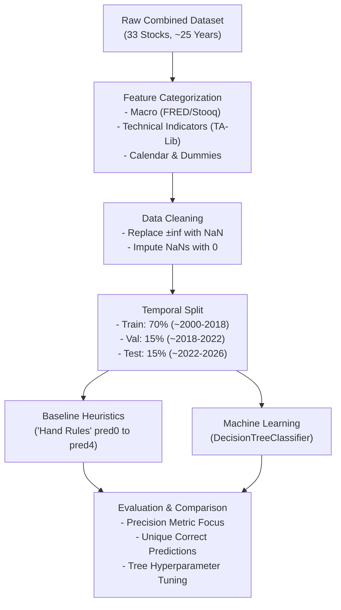

# Module 3: Time Series Modeling — Comprehensive Summary

> **Course**: Stock Markets Analytics Zoomcamp (2026 Cohort)  
> **Module**: 03 — Time Series Modeling  
> **Environment**: Python 3.12 (managed via `uv`)

---

## 1. High-Level Purpose

Module 3 transitions from exploratory data analysis and feature generation (Module 2) into **predictive modeling and machine learning on financial time series**.

Instead of treating stock prices as independent data points, Module 3 establishes a disciplined methodology for:
1. Formulating a concrete prediction target (`is_positive_growth_30d_future`).
2. Combining **Technical**, **Macroeconomic**, and **Calendar** signals.
3. Preventing **data leakage** using strictly **temporal splits** (never random K-fold).
4. Evaluating predictions against **simple rule-of-thumb heuristics** ("hand rules").
5. Training interpretable **Decision Trees**, evaluating by **Precision** (rather than Accuracy), and tuning hyperparameters to prevent overfitting.

---

## 2. Core Concepts & Architectural Flow



---

## 3. Dataset & Feature Engineering

### 3.1 Target Variable (`TO_PREDICT`)
* **Primary Target**: `is_positive_growth_30d_future`
* **Definition**: A binary flag ($1$ or $0$) answering: *“Will the stock price 30 trading days from today be higher than today’s close?”*
* **Why 30 days?** Short intraday noise is smoothed out, while keeping the horizon actionable for swing and medium-term tactical strategies.

### 3.2 Feature Groups
| Feature Group | Examples | Why It Matters |
| :--- | :--- | :--- |
| **Past Returns** | `growth_1d`, `growth_30d`, `growth_snp500_30d` | Captures individual and market-wide momentum trends. |
| **Technical Indicators** | `cci`, `rsi`, `macd`, `adx`, `aroon`, `bbands`, `atr` (50+ indicators via TA-Lib) | Quantifies overbought/oversold states, trend strength, and volatility. |
| **Macro Indicators** | `DGS10`, `DGS5`, `DGS1` (US Treasury Yields), `FEDFUNDS`, `cpi_core_yoy`, `gdppot_us_yoy` | Represents interest rate regimes, inflation pressures, and macroeconomic cycles. |
| **Calendar / Seasonality** | `Month`, `Weekday`, `Ticker`, `month_wom` (e.g., `October_w1`) | Encodes historical seasonal anomalies and monthly market behavior. |
| **Volume Metrics** | `ln_volume = log(Volume)` | Normalizes heavy volume distributions (using small offsets to avoid $-\infty$). |

---

## 4. Key Rules for Financial Machine Learning

### ⚠️ Rule 1: Always Use Temporal Splits (No Random Splitting!)
* **Standard ML Pitfall**: Using `train_test_split(..., shuffle=True)` or standard K-Fold causes severe **lookahead bias** (data leakage). A model trained on tomorrow's market condition will perform artificially well during testing but fail completely in live trading.
* **The Solution (`temporal_split`)**:
  * **Train Set (70%)**: The earliest historical window (~2000 to ~2018).
  * **Validation Set (15%)**: The intermediate window (~2018 to ~2022).
  * **Test Set (15%)**: The most recent unseen future window (~2022 to September 2026).
  * Training occurs on Train + Validation; final evaluation strictly happens on Test.

### ⚠️ Rule 2: Clean Infinities and Impute Judiciously
* Log transformations ($\ln(0)$) produce $-\infty$, and rolling division by zero produces $+\infty$.
* Tree models in scikit-learn fail when encountering `NaN` or `inf`.
* **Cleaning Pipeline**:
  ```python
  # 1. Replace infinities with NaN
  X_train.replace([np.inf, -np.inf], np.nan, inplace=True)
  X_test.replace([np.inf, -np.inf], np.nan, inplace=True)

  # 2. Impute NaNs with 0 (retains row counts without dropping data)
  X_train.fillna(0, inplace=True)
  X_test.fillna(0, inplace=True)
  ```

### ⚠️ Rule 3: Optimize for Precision, Not Accuracy
* In financial markets, overall accuracy can be misleading (e.g., if the market goes up 55% of the time, predicting $1$ constantly yields 55% accuracy).
* **Precision ($\frac{TP}{TP + FP}$)**: Answers *“When the model generates a buy signal, how often is it actually profitable?”*
* Higher precision minimizes false entries, which directly preserves trading capital and reduces portfolio drawdowns.

---

## 5. Modeling Progression: From Heuristics to ML

### Step 1: Handcrafted "Hand Rules" (Intuition Baseline)
Before training complex models, simple rule-based triggers are established:
* `pred0_manual_cci`: `(cci > 200)` $\rightarrow$ Extreme momentum trigger.
* `pred1_manual_prev_g1`: `(growth_30d > 1)` $\rightarrow$ 30-day upward price momentum.
* `pred2_manual_prev_g1_and_snp`: `(growth_30d > 1) & (growth_snp500_30d > 1)` $\rightarrow$ Dual stock & market momentum confirmation.
* `pred3_manual_dgs10_5`: `(DGS10 <= 4.5) & (DGS5 <= 4)` $\rightarrow$ Favorable interest rate environment.
* `pred4_manual_dgs10_fedfunds`: `(DGS10 > 4) & (FEDFUNDS <= 4.795)` $\rightarrow$ Yield curve spread condition.

### Step 2: Decision Tree Modeling (`DecisionTreeClassifier`)
* **Why Decision Trees?**
  * Naturally handles non-linear boundaries between technical levels and macro interest rates.
  * Fast to fit and fully interpretable (can visualize exact decision nodes).
* **Inspection & Visual Rules**:
  * Visualizing top levels (`plot_tree(clf, max_depth=2)` or `export_text(clf)`).
  * Analyzing `clf.feature_importances_` to identify key market drivers (e.g., Treasury yields like `DGS10` and `FEDFUNDS`).

### Step 3: Measuring "Unique Predictions"
* **The Question**: *Is the machine learning model actually finding patterns that simple human heuristics miss?*
* **The Metric (`only_pred5_is_correct`)**:
  $$\text{only\_pred5\_is\_correct} = (\text{pred5} == y) \land (\text{pred0} \neq y) \land (\text{pred1} \neq y) \land (\text{pred2} \neq y) \land (\text{pred3} \neq y) \land (\text{pred4} \neq y)$$
* Counts how many times the ML model was right while **all** simple rule-of-thumb heuristics were wrong on the test set.

### Step 4: Hyperparameter Tuning (`max_depth`)
* Shallow trees (e.g., depth 1–3) underfit the relationship.
* Deep trees (e.g., depth $\ge 15$) memorize market noise and overfit.
* **Tuning Protocol**: Iterate `max_depth` from 1 to 12 with a fixed `random_state=42`, measure precision on the TEST dataset, and pick the depth maximizing test precision.

---

## 6. Homework 3 (Week 3) Quick Reference

| HW Question | Focus | Key Method / Formula | Expected Output / Goal |
| :--- | :--- | :--- | :--- |
| **Q1** | Seasonality & Dummies | `(d.day - 1) // 7 + 1` combined with Month (e.g. `'October_w1'`), `pd.get_dummies()`, `.corr()` | Highest absolute correlation value (`abs_corr`) rounded to 3 decimal places. |
| **Q2** | Macro Hand Rules | Implement `pred3` (`DGS10 <= 4.5 & DGS5 <= 4`) and `pred4` (`DGS10 > 4 & FEDFUNDS <= 4.795`) | Calculate Precision score on the TEST set for the best rule. |
| **Q3** | Unique Predictions | Train `DecisionTreeClassifier(max_depth=10, random_state=42)` $\rightarrow$ predict `pred5_clf_10` | Count test set rows where `pred5` is correct and `pred0..pred4` are all incorrect. |
| **Q4** | Hyperparameter Tuning | Loop `max_depth` in `range(1, 13)` with `random_state=42` | Identify `best_max_depth` achieving highest precision on the TEST set. |
| **Q5** | Missing Data / Discussion | Exploratory analysis | Propose additional high-value metrics (sentiment, order book, etc.). |

---

## 7. Local Environment Guide (`uv` & Python 3.12)

The workspace has been configured with `.python-version` pinned to `3.12`.

### Useful Commands:
```bash
# Verify Python version (should report Python 3.12.x)
uv run python --version

# Run any script or interactive session
uv run python script.py

# Launch Jupyter Notebook / Lab with the Python 3.12 environment
uv run jupyter notebook
```
